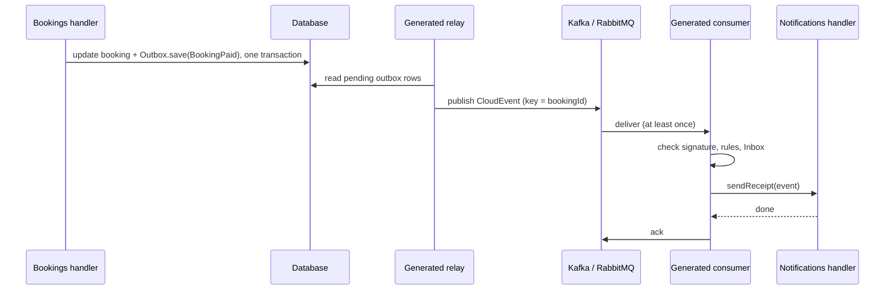

# Veld Rules, Events and Platform: one contract for the API, its events and the business rules they must keep

> **Status:** proposal, approved in direction on 2026-11-22. Not normative. Phase 0 turns it into `spec/rules.md`.

Today a Veld contract says what data looks like. This plan makes it say what is *allowed to happen*: invariants, state transitions, permissions, guarantees and the events services exchange. Veld compiles those rules into native code for every target, checks them for contradictions before anything runs, and tests your real server against them.

## Contents
1. [The pitch](#1-the-pitch)
2. [One contract, end to end](#2-one-contract-end-to-end)
3. [Five rule kinds](#3-five-rule-kinds)
4. [Where rules run](#4-where-rules-run)
5. [Semantics](#5-semantics-engineers-will-check-first)
6. [OCL or not?](#6-should-we-use-ocl)
7. [What makes it a killer feature](#7-what-makes-it-a-killer-feature)
8. [How we build it](#8-how-we-build-it)
9. [Roadmap](#9-roadmap)
10. [Testing](#10-testing)
11. [Events and messaging](#11-events-and-messaging-kafka-rabbitmq-nats-sqs)
12. [Platform features](#12-platform-features)
13. [Non-goals and risks](#13-non-goals-and-risks)
14. [Decisions](#14-decisions)

## 1. The pitch

In most companies one business rule lives in five places: a frontend form check, a backend service, a database constraint, a test, and a wiki page. They drift. The frontend allows a 31-day booking that the backend rejects, a mobile client ships with last year's refund rule, and nobody can say which version is the truth.

Veld already removes that drift for *shapes*: one contract generates the server types and every client. Rules are the same problem one level up.

- **Write the rule once** in the contract, next to the type or endpoint it protects.
- **Veld generates the enforcement** in TypeScript, Node, Java and Rust: plain code, no rule engine, no runtime dependency.
- **The handler only runs on valid, permitted, legal requests.** Your code holds the actual business logic and data access; it never repeats the checks.
- **The rules are checked statically** for contradictions, dead states and breaking changes, and **tested against your running server** with `veld test`.

> The line we never cross: Veld enforces rules at the boundary of an operation. It does not become a programming language. Rule expressions are pure, total and bounded, which is exactly what lets us generate them identically in four languages and reason about them with a solver.

## 2. One contract, end to end

A hotel booking service. Everything below is proposed syntax; it extends the existing v2 grammar without changing anything that exists.

```veld
use iam.users.{User}

/// The signed-in caller. Declared once per project; @auth fills it in.
principal User

model Room {
  id: uuid
  capacity: int @min(1)
  closed: bool
  ownerId: uuid
}

model Booking {
  id: uuid @readonly
  roomId: uuid
  guestId: uuid
  start: datetime
  end: datetime
  guests: int @min(1)
  total: decimal
  status: BookingStatus = .pending
  paidAt?: datetime

  // Invariants: true for every Booking, in requests and responses.
  rule endAfterStart: end > start
    message "A booking must end after it starts"
  rule maxStay: end - start <= days(30)
  rule paidHasTime: status in [.paid, .checkedIn] implies has(paidAt)
}

// A state machine. Only these moves are legal.
enum BookingStatus {
  pending, paid, checkedIn, cancelled, refunded
  flow pending -> paid -> checkedIn
  flow pending -> cancelled
  flow paid -> refunded
  final checkedIn, cancelled, refunded
}

// Authorization, Cedar-style: deny by default, forbid beats permit.
policy ManageBooking(user: User, booking: Booking) {
  permit when booking.guestId == user.id
  permit when "support" in user.roles
  forbid when user.suspended
}

error RoomFull 409 { capacity: int }
error RoomClosed 409
error AmountMismatch 422 { expected: decimal }

@auth(bearer)
service Bookings at "/bookings" {
  post "/" createBooking(body: NewBooking) -> 201 Booking | RoomFull | RoomClosed {
    fact room: Room = body.roomId            // your code loads it; Veld checks it
    require not room.closed            else RoomClosed
    require body.guests <= room.capacity else RoomFull { capacity: room.capacity }
    require body.start >= now                // the server clock, injected
    ensure  result.status == .pending        // a guarantee your handler must keep
  }

  post "/{id}/pay" payBooking(id: uuid, body: Payment) -> Booking | AmountMismatch {
    fact booking: Booking = id
    allow ManageBooking(user, booking)
    transition booking.status: pending -> paid
    require body.amount == booking.total else AmountMismatch { expected: booking.total }
  }
}

// Executable examples: documentation that is also a test.
example "a full room is rejected" {
  given room = { capacity: 2, closed: false }
  createBooking(body: { guests: 3 }) -> RoomFull { capacity: 2 }
}
example "only the guest or support can pay" {
  given booking = { status: .pending, guestId: "u-1" }
  as { id: "u-2", roles: [] }
  payBooking(id: booking.id, body: { amount: booking.total }) -> Forbidden
}
```

### What the developer writes after `veld generate`

Only the parts Veld cannot know: how to load facts, and the business logic itself. The generated types make it impossible to forget a fact loader or skip a check.

```ts
// src/bookings.ts (hand-written, against generated interfaces)
export const facts: BookingsFacts = {
  room:    (roomId)    => db.rooms.find(roomId),      // undefined -> generated 404
  booking: (bookingId) => db.bookings.find(bookingId),
};

export const handlers: BookingsHandlers = {
  // Runs only after: shape, invariants, auth, policy, transition and every require passed.
  async payBooking({ booking, body }) {
    await payments.charge(body);
    return { ...booking, status: "paid", paidAt: new Date() };  // invariants + ensure checked on the way out
  },
  // ...
};
```

## 3. Five rule kinds

| Kind | Written as | Checked where | On failure |
|---|---|---|---|
| **Invariant** | `rule name: expr` in a model | Client before send, server on decode, server on encode | `422 ValidationError` listing every violated rule |
| **Precondition** | `require expr else Error` in an endpoint | Server, after facts load, before the handler | The named declared error, or 422 |
| **State transition** | `flow a -> b` in an enum, `transition x: a -> b` on an endpoint | Server, before the handler, and the returned value after it | `409 InvalidTransition` (implicit, like ValidationError today) |
| **Policy** | `policy` with `permit`/`forbid`, used by `allow` | Server, after auth and facts | `403 Forbidden` (implicit) |
| **Postcondition** | `ensure expr` in an endpoint | Server, on the handler's result | Set in `veld.toml` per environment (§4): `strict` returns `500 Internal`, `audit` logs a violation event, `off` skips the check |

Plus **examples**, which are not enforced at runtime but become tests (§7).

### Built on top of the five kinds

| Feature | Written as | What it gives you |
|---|---|---|
| **Old values** | `ensure result.balance == old(account.balance) - body.amount` | Postconditions that describe the change, like OCL's `@pre`. `old()` reads the fact as it was loaded before the handler ran. |
| **Allowed-action helpers** | generated from `policy`, `flow` and `require` | Clients get `canPayBooking(booking, user)` and `nextStates(booking.status)`, so the UI shows only the buttons the server would accept. The server still decides. |
| **Optimistic concurrency** | `version: long @version` on a model | Generated `ETag`/`If-Match` handling and an implicit `409 Conflict` when two people edit the same record. |
| **Idempotency** | `@idempotent(header: "Idempotency-Key")` on an endpoint | A generated key store interface you implement (Redis, a table). A retried payment returns the first result instead of charging twice. |
| **Derived fields** | `total: decimal = sum(items, i => i.price * i.qty)` | Client and server compute the value with the same generated code, so the cart and the checkout never disagree. The server ignores a client-sent value. |
| **Transition events** | `flow pending -> paid emits BookingPaid` | A typed publisher (§11); the event is part of the contract and can also feed the existing SSE and WebSocket streams. |

## 4. Where rules run

Every generated server runs the same pipeline. The order is part of the spec, so a Java server and a Node server reject the same request with the same error.

```mermaid
flowchart LR
  A[Decode and shape checks] --> B[Invariants on input]
  B --> C[Auth: principal]
  C --> D[Load facts: your code]
  D --> E[Policies: allow]
  E --> F[Transition guard]
  F --> G[require, in order]
  G --> H[Your handler]
  H --> I[Invariants on output]
  I --> J[ensure and target state]
  J --> K[Encode]
```



- **Clients** run step B before sending, so users see the same message the server would give, without a round trip. Steps that need facts or a principal run on the server only.
- **Violations** use the existing problem+json error with a new `violations` array. Each entry carries a stable rule id built like today's signatures, a JSON pointer and the message:
  ```json
  { "type": "veld:bookings/ValidationError@5e1d0c42", "status": 422,
    "violations": [{ "rule": "veld:bookings/Booking.endAfterStart@91c0d2aa",
                     "path": "/end", "message": "A booking must end after it starts" }] }
  ```
- **Observability:** each server exposes one `onRuleViolation(event)` hook with rule id, operation, outcome and timing, so teams can graph which rules fire in production.
- **Rollout:** `@rollout(audit)` on a rule makes the server log would-be violations without rejecting. You dark-launch a new rule, watch the hook for a week, then remove the annotation.

### Enforcement is the developer's choice, in `veld.toml`

Checks on the server's own output (`ensure`, output invariants, the target state of a transition) can be tuned per environment. Checks on what callers send (input invariants, `require`, policies, transition guards) are always enforced: they protect the server, so no config can turn them off.

```toml
[rules]
ensure  = "strict"        # strict | audit | off. The default when no environment matches.
sample  = 1.0             # share of responses checked in audit mode

[rules.env.production]
ensure  = "audit"         # log the violation event, still send the response
sample  = 0.1

[rules.env.test]
ensure  = "strict"        # fail loudly in CI and in veld test --live
```

- The generated server picks the environment from `VELD_ENV`, or from an option passed to the generated `createServer`, so one build runs strict in staging and audit in production.
- Precedence: `@rollout(...)` on a single rule, then the matching `[rules.env.*]` table, then `[rules]`. With no `[rules]` table at all, the default is strict.
- `veld check` warns when `production` is set to `off`, and the setting is printed in the startup log so nobody runs unchecked by accident.

## 5. Semantics engineers will check first

A rule language is only trustworthy if it means the same thing everywhere. These decisions are each enforced by the shared rule test vectors (§10).

| Topic | Decision | Why |
|---|---|---|
| Power | Pure, total, terminating. No user functions, no recursion, no mutation. Iteration only through `all`, `any`, `count`, `sum`, `min`, `max` over lists in the input. | Same result in every language, always finishes, and a solver can reason about it. |
| Cost | The compiler estimates worst-case cost from `@length(max:)`. Nested comprehensions over unbounded lists are a warning. | A rule can never be a denial-of-service. CEL does the same for Kubernetes. |
| Missing values | Two-valued logic. Reading an optional field needs a guard (`has(x)`, `x?.y` or `implies`); an unguarded read is a compile error. | Avoids OCL's `null`/`invalid` four-valued logic and every null-pointer error at runtime. |
| Numbers | `int`/`long` arithmetic is checked; overflow fails the rule closed with a `rule_eval_error`. `decimal` is exact. `==` on `float` is a lint warning. | JS numbers, Java `long` and Rust `i64` must agree. `long` is already a string on the wire for this reason. |
| Strings | `len` counts Unicode code points. Comparison is by code point. No locale-dependent functions. | JS `.length` and Java `length()` count UTF-16 units; generated code corrects for it. |
| Time | `now` exists only in endpoint blocks and comes from an injected clock. Model invariants cannot use it. | Data valid yesterday stays valid today, and tests are reproducible. |
| Regex | The existing §7.1 subset (`matches(s, "...")`). | Already enforced identically in every target. |
| Reporting | All invariants are evaluated and all violations returned. `require` lines run in written order and the first failure wins. | Forms show every problem at once; preconditions map to one clear error. |
| Identity | Rules are part of a declaration's structural shape, so they feed its signature. | Two copies of `Booking` with different rules are different contracts, and `Veld.same` says so. |

Expression syntax is a deliberate subset of CEL (Google's Common Expression Language): `&& || !`, comparisons, `in`, `has()`, field paths, list and map literals, arithmetic, and the comprehension functions above. We add `implies`, enum literals (`.paid`), `days()`/`hours()` durations and `not` as a readable alias.

## 6. Should we use OCL?

OCL (OMG's Object Constraint Language) is where `inv`, `pre` and `post` come from, and it is the reference any examiner will ask about. We compared it with the languages industry runs in production.

| | OCL | CEL | Cedar | Rego (OPA) | Veld rules |
|---|---|---|---|---|---|
| Made for | UML/MOF model constraints | Config and request validation (Kubernetes, IAM, Envoy) | Authorization policies (AWS) | Policy over JSON documents | API contracts |
| Readable for app developers | low: `self.items->forAll(i \| ...)` | high | high | low, Datalog style | high |
| Fits Veld types | via UML mapping | yes | entities only | untyped | native |
| Null handling | null + invalid | `has()` | `has` | undefined | checked guards |
| Compiles to plain code | Java tools, mostly dated | no, interpreter library | no, engine library | no, engine or Wasm | yes, every target |
| State machines | through UML | no | no | no | yes |
| Static analysis | research tools | types and cost | SMT-verified | tests | types, cost, SMT |

**Verdict: borrow OCL's ideas, not its syntax.**
- **No OCL as the surface language.** It assumes UML class diagrams, reads poorly for backend and frontend developers, has confusing null/invalid semantics, and has no maintained compilers to TypeScript or Rust. It would also add a runtime engine, which breaks the zero-runtime-dependency rule.
- **Keep OCL's model:** invariants, preconditions, postconditions and old-value references. `rule`, `require` and `ensure` are exactly `inv`, `pre` and `post`. Cite this in the thesis as the theoretical basis and related work.
- **Copy CEL's expression syntax and limits,** so the language feels familiar to anyone who has written a Kubernetes validation rule, and so rules can be exported as CEL.
- **Copy Cedar's policy semantics:** deny by default, forbid overrides permit, policies are analyzable.

## 7. What makes it a killer feature

Many tools validate input. No mainstream API tool does all of this from one file, in four languages, with proof that they agree.

- **`veld check --prove`:** rules go to an SMT solver (an optional external Z3, called like a plugin). It reports rules that contradict each other, a `require` that can never pass, a policy that permits nobody, and states that cannot be reached.
- **Rule-aware `veld diff`:** tightening an input rule breaks old clients; loosening an output rule breaks consumers that relied on it; removing a transition breaks callers. With the solver, Veld proves "tighter" or "looser" instead of guessing.
- **`veld test`:** examples run against the generated rule code with mocked facts (milliseconds, no database), or with `--live` against your real server. Veld also generates boundary cases from rules, such as `guests = capacity` and `capacity + 1`.
- **Same verdict in every language:** a shared vector suite runs against the TS, Java and Rust output and a Rust reference evaluator; differential fuzzing compares them on random inputs.
- **Explainable failures:** every rejection names the rule, its signature, the field and the operation. The LSP shows a rule on hover, and the playground evaluates it live.
- **Safe rollout:** `@rollout(audit)` dark-launches a rule; the violation hook feeds dashboards.
- **Living documentation:** OpenAPI export keeps simple rules as JSON Schema and the rest as `x-veld-rules` with CEL text; docs show each state machine as a diagram.
- **Architecture as contract:** the `consumes` graph already limits who may call whom. Lint rules in `veld.toml` add house rules, such as every endpoint has auth.

### The demo that sells it (5 minutes)
1. Show the booking contract. Generate a Node server and a React client.
2. Type 3 guests for a 2-person room in the React form: the client shows the server's exact message instantly.
3. Add a contradictory rule (`guests <= 1` with `@min(2)`). `veld check --prove` rejects it with a counterexample.
4. Generate a Java server from the same file. Run `veld test --live` against both servers: identical results.
5. Change `maxStay` from 30 to 14 days. `veld diff` reports a breaking change for clients before the PR merges.

## 8. How we build it

No new architecture. Rules travel the same path as types: source, AST, semantic passes, IR, generators.

| Crate | Work |
|---|---|
| `veld-compiler` | Keywords (`rule flow final policy permit forbid fact require ensure transition allow example given implies principal event channel publishes subscribes`), an expression parser with precedence climbing, a typing pass for expressions, the state-machine pass (reachability, finals), signatures including rules. New diagnostic range `E09xx`. |
| `veld-ir` | `Expr` (typed, arena-indexed), `Rule`, `StateMachine`, `Policy`, `EndpointRules { facts, allow, transition, requires, ensures }`, `Example`, `Event`, `Channel`. Bump `ir_version`. |
| `veld-rules` (new) | The reference evaluator over IR and JSON values. Used by `veld test`, the playground (WASM), the SMT encoder and as the oracle for differential tests. |
| `veld-codegen` | One shared lowering: `trait ExprPrinter` with per-language hooks for precedence, null guards, code-point length, checked arithmetic and decimal. Emitters only supply the hooks. |
| `emitters/*` | Generated `check<Model>` functions, the fact-loader interface, the endpoint pipeline, the violation hook, event publishers and subscribers. Capability flags `rules.invariants`, `rules.preconditions`, `rules.transitions`, `rules.policies`, `rules.postconditions`, `events`; missing support is `E0801`, as always. |
| `veld-tools` | `diff` rule and event classification, OpenAPI `x-veld-rules`, AsyncAPI export, SMT-LIB encoding for `--prove`, `fmt` for the new syntax. |
| `apps/veld` | `veld test [--live URL]`, `check --prove`, `veld events replay`, LSP hover and completion inside expressions. |

### IR sketch

```rust
pub struct Rule { pub id: RuleId, pub name: String, pub expr: ExprId,
                  pub message: Option<String>, pub rollout: Rollout, pub span: Span }

#[non_exhaustive]
pub enum Expr {
    Lit(Literal), Field(Path), EnumLit(TypeId, VariantId), Now,
    Unary(UnOp, ExprId), Binary(BinOp, ExprId, ExprId),   // includes Implies, In
    Has(Path), Call(Builtin, Vec<ExprId>),                 // len, matches, days, ...
    Comprehension { kind: Quant, list: ExprId, var: VarId, body: ExprId }, // all/any/count/sum
}

pub struct StateMachine { pub enum_id: TypeId, pub edges: Vec<(VariantId, VariantId)>,
                          pub finals: Vec<VariantId> }
```

### Generated code sketch (TypeScript)

```ts
// generated/rules/booking.ts
export const BOOKING_END_AFTER_START = "veld:bookings/Booking.endAfterStart@91c0d2aa";

export function checkBooking(v: Booking, out: Violation[], path = ""): void {
  if (!(v.end.getTime() > v.start.getTime()))
    out.push({ rule: BOOKING_END_AFTER_START, path: path + "/end",
               message: "A booking must end after it starts" });
  if ((v.status === "paid" || v.status === "checkedIn") && v.paidAt === undefined)
    out.push({ rule: BOOKING_PAID_HAS_TIME, path: path + "/paidAt", message: "..." });
}
```

## 9. Roadmap

Each phase ships on its own and is useful alone.

| Phase | Size | Work | Gate |
|---|---|---|---|
| **0. Spec** | 3 days | `spec/rules.md`: grammar in EBNF, typing rules, the semantics table, evaluation order, `E09xx` codes. Rule vector format in `tests/rules/`, 40 starter vectors including Unicode, overflow and missing-value edge cases. | Owner freezes the syntax. |
| **1. Invariants** | 1 week | Parser, typing and IR for `rule`. The `veld-rules` reference evaluator. Codegen for TS client, Node, Java and Rust. The `violations` array. Signatures include rules. | All vectors identical across 4 targets plus reference; toolchain round trips green. |
| **2. Endpoint rules and examples** | 1 week | `fact`, `require`, `ensure` with `old()`, injected clock, the generated pipeline and fact-loader interfaces. The `[rules]` enforcement config and `VELD_ENV`. `example` blocks and `veld test` (offline and `--live`). | The booking example passes `veld test --live` on Node and Java servers. |
| **3. State machines** | 4 days | `flow`, `final`, `transition`, implicit `InvalidTransition`, `emits`. Client `nextStates()` helpers. Unreachable and stuck states in `veld check`. Diagrams in docs and the playground. | Illegal transitions rejected identically by every server. |
| **4. Policies** | 1 week | `principal`, `policy`, `permit`/`forbid`, `allow`, implicit `Forbidden`, client `can<Operation>()` helpers. `@version` optimistic concurrency and `@idempotent`. Lint: every endpoint has auth or `@auth(none)` on purpose. | Policy vectors pass; handler signatures require the principal. |
| **5. Proof and lifecycle** | 1–2 weeks | `check --prove` through an optional external Z3 (cvc5 also accepted), SMT-LIB over stdin like a plugin; without a solver installed, `--prove` says so and the normal checks still run. Rule-aware `diff`, `@rollout(audit)`, violation hook, derived fields. OpenAPI `x-veld-rules`, LSP support, live evaluation in the playground. | The 5-minute demo runs end to end. |
| **6. Extras** | if time | `veld test --coverage`; `veld export rules` (a readable rule book for product people); `@pii`/`@secret` fields redacted in logs and violation events, with a lint for `@pii` returned without auth. | None; each item ships on its own. |

**Chosen scope: phases 0 to 5**, about six weeks for the team, plus the events track (§11). After Phase 0, work splits by layer so phases overlap:
- **Compiler and IR** (one person): parser, typing, state-machine pass, signatures. Stays one phase ahead of the emitters.
- **One person per emitter:** TS client, Node, Java, Rust. Each implements the shared `ExprPrinter` hooks and passes the same vectors.
- **Tools** (one person): the reference evaluator, `veld test`, the SMT encoder, diff, the playground.

If the schedule slips, cut from the end: Phase 6 first, then derived fields and LSP support from Phase 5. The solver and the rule-aware diff stay, because they make the demo.

## 10. Testing

- **Conformance snapshots** for every new diagnostic and for the IR of rules, reviewed by the owner like today.
- **Rule vectors** (`tests/rules/*.json`): rule, input, facts, principal, clock, expected violations or error. Every emitter's generated code and the reference evaluator must agree exactly. This is the rules version of today's wire goldens.
- **Differential fuzzing:** random inputs derived from the types go through all four generated evaluators and the reference; any disagreement is a bug.
- **Toolchain round trips:** the booking service, generated for Node, Java and Rust, rejects and accepts the same requests over real HTTP.
- **Properties:** `fmt` stays idempotent with rules; parse after fmt gives the same IR; the solver never says "contradiction" for rules the reference evaluator can satisfy.

## 11. Events and messaging: Kafka, RabbitMQ, NATS, SQS

Event-driven microservices have the same drift problem as HTTP APIs, and worse tooling. The producer changes a field, a consumer three teams away breaks at 3 a.m., and the dead-letter queue fills with messages nobody can read. Veld extends the contract to asynchronous messages: events are declared like models, channels like services, and the same rules, signatures and breaking-change checks apply.

### In the contract: broker-agnostic

```veld
/// Published when a booking is paid.
event BookingPaid {
  bookingId: uuid
  amount: decimal
  paidAt: datetime
  rule positive: amount > 0              // checked on publish and on consume
}

event BookingCancelled { bookingId: uuid  reason?: string }

/// One logical stream. veld.toml decides whether it is a Kafka topic,
/// a RabbitMQ exchange, a NATS subject or an SQS queue.
channel BookingEvents {
  carries BookingPaid, BookingCancelled
  key bookingId                          // partition / routing key: ordering per booking
  @retry(max: 5, backoff: exponential)
  @deadLetter                            // failed messages go to BookingEvents.dlq
}

service Bookings at "/bookings" {
  publishes BookingEvents
  // ...the HTTP endpoints from §2. A transition can emit directly:
  // flow pending -> paid emits BookingPaid
}

service Notifications {
  subscribes BookingEvents as "notifications" {   // consumer group / queue name
    on BookingPaid      -> sendReceipt
    on BookingCancelled -> sendApology
  }
}

example "a paid booking sends one receipt" {
  given event BookingPaid { bookingId: "b-1", amount: 120.00 }
  expect Notifications.sendReceipt called once
}
```

### In `veld.toml`: the broker binding

```toml
[brokers.main]
kind = "kafka"                 # kafka | rabbitmq | nats | sqs | redis-streams | memory
url  = "env:KAFKA_BROKERS"     # read from the environment, never committed

[channels.BookingEvents]
broker = "main"
name   = "shop.bookings.v1"    # topic / exchange / subject / queue

[brokers.test]
kind = "memory"                # built in, zero dependencies, used by veld test
```

Changing broker means editing the config and regenerating. No handler code changes.

### What gets generated

| Piece | What it does |
|---|---|
| **Typed publisher** | `bookingEvents.publish(BookingPaid{...})`. Invariants run first; an invalid event never leaves the service. |
| **Typed subscriber** | An interface with one method per `on` line. The generated consumer decodes, checks the signature and rules, deduplicates, calls your handler, and acks only after it returns. |
| **Envelope** | CloudEvents 1.0: `type` is the event signature (`veld:bookings/BookingPaid@7ab31c90`), `id` a UUID, `subject` the key, `data` canonical JSON. Any CloudEvents tool can read Veld events. |
| **Transactional outbox** | For `emits`, the event is written through a generated `Outbox` interface in the same database transaction as the state change, and a generated relay publishes it. No lost or phantom events when the service crashes mid-request. |
| **Inbox (deduplication)** | Delivery is at-least-once on every broker. A generated `Inbox` interface records handled event ids, so a redelivered event does not send two receipts. |
| **Retry and dead letter** | From `@retry` and `@deadLetter`. A message that fails the contract goes to the dead-letter channel with the violation attached, so it can be read and replayed with `veld events replay`. |
| **Broker adapters** | The generated core depends only on a small `Transport` interface. Each broker is a framework adapter, the one allowed dependency under rule 3, using the standard client per language, such as `kafka-clients` and Spring Kafka/AMQP for Java, `amqplib` for Node, `rdkafka` and `lapin` for Rust. |



### Checks and tools
- **`veld check`** builds one graph of HTTP calls (`consumes`) and events (`publishes`/`subscribes`): it errors on a subscription to an event nobody publishes and warns on an event nobody consumes. Cycles stay legal.
- **`veld diff`** knows event compatibility. Removing a field or tightening a rule breaks consumers. Adding a required field breaks replay of old messages. Adding an optional field is safe. With the registry, it checks against every published consumer contract.
- **`veld export asyncapi`** writes an AsyncAPI 3.0 document, the event-driven counterpart of the OpenAPI export.
- **`veld test`** runs event examples on the in-memory broker in milliseconds; `--live` runs them against a real broker in Docker.
- **Ordering** is per `key` only, and the docs say so. A consumer that needs order across keys says so in the contract with `@ordered`, which limits the channel to one partition.

### Events roadmap

| Phase | Size | Work | Gate |
|---|---|---|---|
| **E1. Events, channels, memory broker** | 1 week | Syntax, IR and signatures for `event`, `channel`, `publishes`, `subscribes`. CloudEvents envelope. Typed publisher and subscriber in every target; built-in `memory` transport; event examples in `veld test`. | The same event round-trips byte-identically between Node, Java and Rust services. |
| **E2. Kafka and RabbitMQ** | 1 week | Adapters per language, retry and dead letter, inbox deduplication. Toolchain tests against Kafka and RabbitMQ in Docker, run in CI like the registry e2e. | A Node producer and a Java consumer talk over both brokers with only `veld.toml` changed. |
| **E3. Outbox, tools, more brokers** | 1 week | Outbox and relay for `emits`, `veld events replay`, event-aware `diff`, AsyncAPI export. NATS, SQS and Redis Streams adapters. | Crash-test e2e: killing the producer mid-request loses no event and duplicates none. |

E1 can start in parallel with rules Phase 2, since it reuses the same invariants. Events plus rules give the strongest demo: one contract, an HTTP service and a Kafka consumer in two languages, and `veld diff` blocking a change that would break the consumer.

## 12. Platform features

The rule kinds are the engine. These features are built on it and cover what production teams otherwise hand-write in every service: security, data handling, time, workflows and reach. Each one is optional, has its own capability flag, and follows the same pattern: declared in the contract, enforced by generated code, with a small interface for the part only your system can do.

### Security and data

```veld
principal User { id: uuid  tenantId: uuid  roles: string[] }

model Booking {
  tenantId: uuid @tenant                       // every read and write is scoped to the caller's tenant
  guestPhone?: string @pii
    @visible(when: user.id == guestId || "support" in user.roles)
  // ...
}

@auth(bearer)
service Bookings at "/bookings" {
  @audited
  @limit(10 per minute by user)
  post "/{id}/pay" payBooking(id: uuid, body: Payment) -> Booking | AmountMismatch { ... }
}
```

| Feature | What is generated | Details |
|---|---|---|
| **Field visibility** `@visible(when: ...)` | The response encoder drops the field for callers the expression rejects. | The field must be optional on the wire, so clients already handle its absence (compile error otherwise). On an `@audited` endpoint, the audit event records which fields were hidden. |
| **Multi-tenancy** `@tenant` | Fact loaders receive the caller's tenant; every loaded fact and every response is checked against it. | A fact from another tenant becomes `404`, not `403`, so other tenants' records are not even confirmed to exist. Events carry the tenant in the envelope. A tenant-scoped endpoint without auth is a compile error. |
| **Audit log** `@audited` | An `AuditEvent` per call: operation, principal, time, outcome, and before/after values from `old()` facts and the result. | Sent to a generated `AuditSink` interface, or straight to a channel (§11). `@pii` and `@secret` values are redacted. |
| **Rate limits** `@limit(n per window by user\|tenant\|ip)` | A `Limiter` interface with a built-in memory implementation; back it with Redis in production. | Uses the existing prelude `TooManyRequests 429` with `retryAfter`. Generated clients honour `retryAfter` automatically. |

### Workflow and time

```veld
enum BookingStatus {
  pending, paid, checkedIn, cancelled, refunded
  flow pending -> paid -> checkedIn
  flow pending -> cancelled after hours(24)     // unpaid bookings expire on their own
  // ...
}

model Booking {
  rule maxStay: end - start <= days(14) when flag("shortStays")
}

@timeout(seconds(2))
@slo(p99: ms(300), errors: 0.1%)
get "/{id}" getBooking(id: uuid) -> Booking

saga Checkout(body: CheckoutRequest) -> Booking {
  step hold:    Rooms.hold(body.roomId)         compensate Rooms.release(hold.id)
  step charge:  Payments.charge(body.payment)   compensate Payments.refund(charge.id)
  step confirm: Bookings.confirm(hold.id)
  timeout minutes(5)
}
```

| Feature | What is generated | Details |
|---|---|---|
| **Timed transitions** `after duration` | A `Scheduler` interface: entering `pending` schedules the timeout; when it fires, the transition runs through the normal pipeline. | The state is re-checked when the timer fires, so a booking paid at hour 23 is not cancelled. A generated `runDueTransitions()` also works from a plain cron job. `emits` events fire as usual. |
| **Sagas** `saga` with `step` and `compensate` | An orchestrator per saga, its state saved through a `SagaStore` interface, with retries and compensation in reverse order. | `veld check` requires every step and compensation to be `@idempotent`, because they are retried. Steps call other services through the generated clients (`consumes`) or through channels. The saga itself is an endpoint with a typed result. This is the largest feature in the plan. |
| **Feature flags** `when flag("name")` | A `FlagProvider` interface (config file, LaunchDarkly, Unleash), evaluated with the principal and tenant. | Works on `rule`, `require`, `permit` and `flow`. `veld check` lists every flag the contract uses. `veld diff` reports a flag-gated tightening as "breaking once the flag is on". |
| **Timeouts and SLOs** `@timeout`, `@slo` | Client default timeouts and a server-side deadline in the request context; latency and error metrics through one metrics hook with stable names. | Metric names follow OpenTelemetry conventions, so any exporter can read them without adding a dependency to the generated code. `veld export slo` writes OpenSLO files for alerting. |

### Reach and adoption

| Feature | What is generated | Details |
|---|---|---|
| **AI agent tools** `veld export mcp` | MCP tool definitions from the contract: names, `///` docs as descriptions, JSON Schema inputs, and rules described in plain text. An optional generated MCP server proxies calls through the generated client. | Agents get the same rule checks and the same policies as any caller; the agent acts as its user's principal. Non-`get` endpoints are marked destructive. `@agent(hidden)` keeps an endpoint out of the tool list. |
| **Translated messages** | A message catalog per language, `messages/ar.toml`, `messages/fr.toml`, keyed by rule id; the English text stays inline in the contract. | The server picks the language from `Accept-Language`; each violation carries both `message` and a stable `messageKey`, so clients can translate themselves. `veld check` warns about missing translations. Arabic is the first catalog in the example project. |
| **Data retention** `@retain(days(30), then: delete\|anonymize)` | A `RetentionJobs` hook listing what to delete or anonymize and when, and `veld export retention`: a data inventory of every `@pii` field and how long it is kept. | Together with `@pii` this answers the GDPR questions "what personal data do you store, and for how long" straight from the contract. |

### Platform roadmap

| Phase | Size | Work | Gate |
|---|---|---|---|
| **P1. Security and data** | 1 week | `@visible`, `@tenant`, `@audited`, `@limit` in every target. | Cross-tenant and hidden-field vectors pass on all four servers. |
| **P2. Time, flags and SLOs** | 1 week | Timed transitions and the scheduler hook, `flag()` and the flag provider, `@timeout`, `@slo`, the metrics hook and the OpenSLO export. | An expiring booking is cancelled exactly once, also when paid just before the deadline. |
| **P3. Sagas** | 2 weeks | Syntax, the idempotency check, the orchestrator and `SagaStore`, steps over HTTP and channels. | Killing the orchestrator at every step still ends in either a confirmed booking or a fully compensated one. |
| **P4. Reach** | 1 week | `veld export mcp` and the MCP proxy, message catalogs, `@retain` and the retention export. | An AI agent books a room through the MCP tools and is stopped by the same rules as the React client. |

## 13. Non-goals and risks

### What belongs in the contract, and what stays in code

| In the contract | In your code |
|---|---|
| Rules over the request, its facts and the result | Loading facts: queries, caches, other services |
| Which state moves are legal | What happens during the move: charging, emails, events |
| Who may perform an operation | How users and roles are stored |
| Guarantees about the response | Computing the response |
| Which events exist and who publishes and consumes them | What a consumer does with an event |
| | Rules across many records (uniqueness, quotas): enforce in the database, and declare the error in the contract |

### Risks
- **Scope creep into a programming language.** Every request for user functions, loops or I/O gets the same answer: load it as a fact. This is written into the spec.
- **Semantic drift between languages.** Covered by vectors and differential fuzzing, run in CI on every push.
- **Performance.** Rules compile to straight-line code with a cost bound; a CI benchmark fails if the overhead per request passes a fixed budget.
- **Broker adapters multiply the test matrix.** Every adapter is tested against the same event vectors on the memory broker first; only E2/E3 toolchain tests need real brokers.
- **Adoption.** Everything is optional and incremental. A contract with no rules or events generates exactly what it does today, byte for byte.

## 14. Decisions

| Question | Decision (2026-11-22) |
|---|---|
| Rule language | Veld's own syntax: CEL-style expressions, Cedar-style policies, OCL cited as the foundation |
| Keywords | `rule` / `require` / `ensure` |
| Output checks in production | The developer chooses in `veld.toml`, per environment (§4) |
| Solver | Optional external Z3, called like a plugin; `veld` stays one binary |
| Scope | Phases 0 to 5; Phase 6 if time allows |
| Events | Track E1 to E3. First brokers: Kafka and RabbitMQ, plus the built-in memory broker; NATS, SQS and Redis Streams in E3 |
| Platform features | All eleven accepted as track P1 to P4 (§12) |
| Overall size | Rules 0–5 (about 6 weeks), events E1–E3 (3 weeks), platform P1–P4 (5 weeks). With the three tracks overlapping, about 10 to 12 weeks for the team. Cut order if needed: Phase 6, then P4, then sagas (P3), then E3. |

**Next step:** Phase 0, `spec/rules.md` and the first 40 rule vectors, for the owner to freeze.
