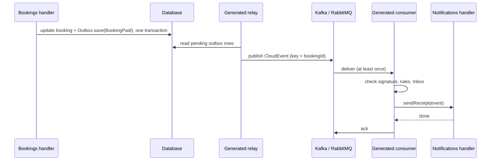
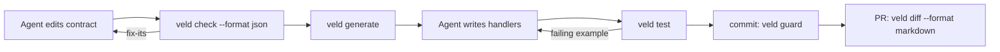

# Veld Rules, Events, Platform and Agents: one contract for the API, its events and the business rules they must keep

> **Status:** proposal, approved in direction on 2026-11-22. Not normative. Phase 0 turns it into `spec/rules.md`.
> Implementation started on 2026-11-24 on the branch `feat/rules-and-events`. Who builds what is in [§18](#18-who-builds-what); progress is tracked in `docs/proposals/rules-and-events-status.md` on that branch.

Today a Veld contract says what data looks like. This plan makes it say what is *allowed to happen*: invariants, state transitions, permissions, guarantees and the events services exchange. Veld compiles those rules into native code for every target, checks them for contradictions before anything runs, and tests your real server against them.

## Contents
1. [The pitch](#1-the-pitch)
2. [One contract, end to end](#2-one-contract-end-to-end)
3. [Five rule kinds](#3-five-rule-kinds)
4. [Where rules run](#4-where-rules-run)
5. [Semantics](#5-semantics-engineers-will-check-first)
6. [OCL or not?](#6-should-we-use-ocl)
7. [What makes it a killer feature](#7-what-makes-it-a-killer-feature)
8. [How we build it](#8-how-we-build-it)
9. [Roadmap](#9-roadmap)
10. [Testing](#10-testing)
11. [Events and messaging](#11-events-and-messaging-kafka-rabbitmq-nats-sqs)
12. [Platform features](#12-platform-features)
13. [Configuration for big projects](#13-configuration-for-big-projects)
14. [AI coding agents](#14-ai-coding-agents)
15. [Beyond web: mobile and desktop](#15-beyond-web-mobile-and-desktop)
16. [Non-goals and risks](#16-non-goals-and-risks)
17. [Decisions](#17-decisions)
18. [Who builds what](#18-who-builds-what)

## 1. The pitch

In most companies one business rule lives in five places: a frontend form check, a backend service, a database constraint, a test, and a wiki page. They drift. The frontend allows a 31-day booking that the backend rejects, a mobile client ships with last year's refund rule, and nobody can say which version is the truth.

Veld already removes that drift for *shapes*: one contract generates the server types and every client. Rules are the same problem one level up.

- **Write the rule once** in the contract, next to the type or endpoint it protects.
- **Veld generates the enforcement** in TypeScript, Node, Java and Rust: plain code, no rule engine, no runtime dependency.
- **The handler only runs on valid, permitted, legal requests.** Your code holds the actual business logic and data access; it never repeats the checks.
- **The rules are checked statically** for contradictions, dead states and breaking changes, and **tested against your running server** with `veld test`.

> The line we never cross: Veld enforces rules at the boundary of an operation. It does not become a programming language. Rule expressions are pure, total and bounded, which is exactly what lets us generate them identically in four languages and reason about them with a solver.

## 2. One contract, end to end

A hotel booking service. Everything below is proposed syntax; it extends the existing v2 grammar without changing anything that exists.

```veld
use iam.users.{User}

/// The signed-in caller. Declared once per project; @auth fills it in.
principal User

model Room {
  id: uuid
  capacity: int @min(1)
  closed: bool
  ownerId: uuid
}

model Booking {
  id: uuid @readonly
  roomId: uuid
  guestId: uuid
  start: datetime
  end: datetime
  guests: int @min(1)
  total: decimal
  status: BookingStatus = .pending
  paidAt?: datetime

  // Invariants: true for every Booking, in requests and responses.
  rule endAfterStart: end > start
    message "A booking must end after it starts"
  rule maxStay: end - start <= days(30)
  rule paidHasTime: status in [.paid, .checkedIn] implies has(paidAt)
}

// A state machine. Only these moves are legal.
enum BookingStatus {
  pending, paid, checkedIn, cancelled, refunded
  flow pending -> paid -> checkedIn
  flow pending -> cancelled
  flow paid -> refunded
  final checkedIn, cancelled, refunded
}

// Authorization, Cedar-style: deny by default, forbid beats permit.
policy ManageBooking(user: User, booking: Booking) {
  permit when booking.guestId == user.id
  permit when "support" in user.roles
  forbid when user.suspended
}

error RoomFull 409 { capacity: int }
error RoomClosed 409
error AmountMismatch 422 { expected: decimal }

@auth(bearer)
service Bookings at "/bookings" {
  post "/" createBooking(body: NewBooking) -> 201 Booking | RoomFull | RoomClosed {
    fact room: Room = body.roomId            // your code loads it; Veld checks it
    require not room.closed            else RoomClosed
    require body.guests <= room.capacity else RoomFull { capacity: room.capacity }
    require body.start >= now                // the server clock, injected
    ensure  result.status == .pending        // a guarantee your handler must keep
  }

  post "/{id}/pay" payBooking(id: uuid, body: Payment) -> Booking | AmountMismatch {
    fact booking: Booking = id
    allow ManageBooking(user, booking)
    transition booking.status: pending -> paid
    require body.amount == booking.total else AmountMismatch { expected: booking.total }
  }
}

// Executable examples: documentation that is also a test.
example "a full room is rejected" {
  given room = { capacity: 2, closed: false }
  createBooking(body: { guests: 3 }) -> RoomFull { capacity: 2 }
}
example "only the guest or support can pay" {
  given booking = { status: .pending, guestId: "u-1" }
  as { id: "u-2", roles: [] }
  payBooking(id: booking.id, body: { amount: booking.total }) -> Forbidden
}
```

### What the developer writes after `veld generate`

Only the parts Veld cannot know: how to load facts, and the business logic itself. The generated types make it impossible to forget a fact loader or skip a check.

```ts
// src/bookings.ts (hand-written, against generated interfaces)
export const facts: BookingsFacts = {
  room:    (roomId)    => db.rooms.find(roomId),      // undefined -> generated 404
  booking: (bookingId) => db.bookings.find(bookingId),
};

export const handlers: BookingsHandlers = {
  // Runs only after: shape, invariants, auth, policy, transition and every require passed.
  async payBooking({ booking, body }) {
    await payments.charge(body);
    return { ...booking, status: "paid", paidAt: new Date() };  // invariants + ensure checked on the way out
  },
  // ...
};
```

## 3. Five rule kinds

| Kind | Written as | Checked where | On failure |
|---|---|---|---|
| **Invariant** | `rule name: expr` in a model | Client before send, server on decode, server on encode | `422 ValidationError` listing every violated rule |
| **Precondition** | `require expr else Error` in an endpoint | Server, after facts load, before the handler | The named declared error, or 422 |
| **State transition** | `flow a -> b` in an enum, `transition x: a -> b` on an endpoint | Server, before the handler, and the returned value after it | `409 InvalidTransition` (implicit, like ValidationError today) |
| **Policy** | `policy` with `permit`/`forbid`, used by `allow` | Server, after auth and facts | `403 Forbidden` (implicit) |
| **Postcondition** | `ensure expr` in an endpoint | Server, on the handler's result | Set in the runtime config (§4, §13): `strict` returns `500 Internal`, `audit` logs a violation event, `off` skips the check |

Plus **examples**, which are not enforced at runtime but become tests (§7).

### Built on top of the five kinds

| Feature | Written as | What it gives you |
|---|---|---|
| **Old values** | `ensure result.balance == old(account.balance) - body.amount` | Postconditions that describe the change, like OCL's `@pre`. `old()` reads the fact as it was loaded before the handler ran. |
| **Allowed-action helpers** | generated from `policy`, `flow` and `require` | Clients get `canPayBooking(booking, user)` and `nextStates(booking.status)`, so the UI shows only the buttons the server would accept. The server still decides. |
| **Optimistic concurrency** | `version: long @version` on a model | Generated `ETag`/`If-Match` handling and an implicit `409 Conflict` when two people edit the same record. |
| **Idempotency** | `@idempotent(header: "Idempotency-Key")` on an endpoint | A generated key store interface you implement (Redis, a table). A retried payment returns the first result instead of charging twice. |
| **Derived fields** | `total: decimal = sum(items, i => i.price * i.qty)` | Client and server compute the value with the same generated code, so the cart and the checkout never disagree. The server ignores a client-sent value. |
| **Transition events** | `flow pending -> paid emits BookingPaid` | A typed publisher (§11); the event is part of the contract and can also feed the existing SSE and WebSocket streams. |
| **Form (partial) validation** | generated: `checkBooking.partial(draft)` | Real forms are half-filled. The partial check runs only the rules whose fields are present, so a form shows errors as the user types without flagging fields they have not reached. React and Vue get per-field helpers. |
| **Stale-client safety** | generated, no syntax | Client-side checks add a risk: an old app keeps blocking a request the server now allows. Every response carries the server's rules digest in a `Veld-Rules` header. A client generated from different rules notices, stops rejecting locally, lets the server decide, and calls `onContractMismatch`. |

## 4. Where rules run

Every generated server runs the same pipeline. The order is part of the spec, so a Java server and a Node server reject the same request with the same error.

```mermaid
flowchart LR
  A[Auth: principal] --> B[Decode and shape checks]
  B --> C[Invariants on input]
  C --> D[Load facts: your code]
  D --> E[Policies: allow]
  E --> F[Transition guard]
  F --> G[require, in order]
  G --> H[Your handler]
  H --> I[Invariants on output]
  I --> J[ensure and target state]
  J --> K[Encode]
```



- **Auth runs first**, then middleware, as generated servers already do today. An unauthenticated caller gets `401` and learns nothing about the rules.
- **Clients** run the invariants step before sending, so users see the same message the server would give, without a round trip. Steps that need facts or a principal run on the server only.
- **Violations** use the existing problem+json error with a new `violations` array. Each entry carries a stable rule id built like today's signatures, a JSON pointer and the message:
  ```json
  { "type": "veld:bookings/ValidationError@5e1d0c42", "status": 422,
    "violations": [{ "rule": "veld:bookings/Booking.endAfterStart@91c0d2aa",
                     "path": "/end", "message": "A booking must end after it starts" }] }
  ```
- **Observability:** each server exposes one `onRuleViolation(event)` hook with rule id, operation, outcome and timing, so teams can graph which rules fire in production.
- **Rollout:** `@rollout(audit)` on a rule makes the server log would-be violations without rejecting. You dark-launch a new rule, watch the hook for a week, then remove the annotation.

### Enforcement is the developer's choice, through the runtime config

Checks on the server's own output (`ensure`, output invariants, the target state of a transition) can be tuned per deployment. Checks on what callers send (input invariants, `require`, policies, transition guards) are always enforced: they protect the server, so no setting can turn them off.

The setting is part of the typed runtime config (§13), not `veld.toml`, because it changes per deployment, not per generation. You fill it from wherever your app keeps settings:

```ts
// src/main.ts
createServer(handlers, facts, {
  rules: { ensure: settings.prod ? "audit" : "strict", sample: 0.1 },  // strict | audit | off
  // ...service URLs, broker settings
});
```

- Precedence: `@rollout(...)` on a single rule, then the runtime config. With nothing set, the default is strict.
- The generated server logs the active mode at startup, so nobody runs unchecked by accident.

## 5. Semantics engineers will check first

A rule language is only trustworthy if it means the same thing everywhere. These decisions are each enforced by the shared rule test vectors (§10).

| Topic | Decision | Why |
|---|---|---|
| Power | Pure, total, terminating. No user functions, no recursion, no mutation. Iteration only through `all`, `any`, `count`, `sum`, `min`, `max` over lists in the input. | Same result in every language, always finishes, and a solver can reason about it. |
| Cost | The compiler estimates worst-case cost from `@length(max:)`. Nested comprehensions over unbounded lists are a warning. | A rule can never be a denial-of-service. CEL does the same for Kubernetes. |
| Missing values | Two-valued logic. Reading an optional field needs a guard (`has(x)`, `x?.y` or `implies`); an unguarded read is a compile error. | Avoids OCL's `null`/`invalid` four-valued logic and every null-pointer error at runtime. |
| Numbers | `int`/`long` arithmetic is checked; overflow fails the rule closed with a `rule_eval_error`. `decimal` is exact. `==` on `float` is a lint warning. | JS numbers, Java `long` and Rust `i64` must agree. `long` is already a string on the wire for this reason. |
| Strings | `len` counts Unicode code points. Comparison is by code point. No locale-dependent functions. | JS `.length` and Java `length()` count UTF-16 units; generated code corrects for it. |
| Time | `now` exists only in endpoint blocks and comes from an injected clock. Model invariants cannot use it. | Data valid yesterday stays valid today, and tests are reproducible. |
| Regex | The existing §7.1 subset (`matches(s, "...")`). | Already enforced identically in every target. |
| Reporting | All invariants are evaluated and all violations returned. `require` lines run in written order and the first failure wins. | Forms show every problem at once; preconditions map to one clear error. |
| Identity | Every rule has its own signed id, `veld:bookings/Booking.maxStay@…`, a hash of its canonical expression. A declaration's own signature stays about wire shape only, exactly like `@min` and `@max` today. | Tightening a rule must not break typed error matching in apps that are already deployed. `veld diff` still reports the change, and the rules digest tells a client that its rules are stale. (Changed on 2026-11-24; the first draft put rules into the declaration signature.) |

Expression syntax is a deliberate subset of CEL (Google's Common Expression Language): `&& || !`, comparisons, `in`, `has()`, field paths, list and map literals, arithmetic, and the comprehension functions above. We add `implies`, enum literals (`.paid`), `days()`/`hours()` durations and `not` as a readable alias.

## 6. Should we use OCL?

OCL (OMG's Object Constraint Language) is where `inv`, `pre` and `post` come from, and it is the reference any examiner will ask about. We compared it with the languages industry runs in production.

| | OCL | CEL | Cedar | Rego (OPA) | Veld rules |
|---|---|---|---|---|---|
| Made for | UML/MOF model constraints | Config and request validation (Kubernetes, IAM, Envoy) | Authorization policies (AWS) | Policy over JSON documents | API contracts |
| Readable for app developers | low: `self.items->forAll(i \| ...)` | high | high | low, Datalog style | high |
| Fits Veld types | via UML mapping | yes | entities only | untyped | native |
| Null handling | null + invalid | `has()` | `has` | undefined | checked guards |
| Compiles to plain code | Java tools, mostly dated | no, interpreter library | no, engine library | no, engine or Wasm | yes, every target |
| State machines | through UML | no | no | no | yes |
| Static analysis | research tools | types and cost | SMT-verified | tests | types, cost, SMT |

**Verdict: borrow OCL's ideas, not its syntax.**
- **No OCL as the surface language.** It assumes UML class diagrams, reads poorly for backend and frontend developers, has confusing null/invalid semantics, and has no maintained compilers to TypeScript or Rust. It would also add a runtime engine, which breaks the zero-runtime-dependency rule.
- **Keep OCL's model:** invariants, preconditions, postconditions and old-value references. `rule`, `require` and `ensure` are exactly `inv`, `pre` and `post`. Cite this in the thesis as the theoretical basis and related work.
- **Copy CEL's expression syntax and limits,** so the language feels familiar to anyone who has written a Kubernetes validation rule, and so rules can be exported as CEL.
- **Copy Cedar's policy semantics:** deny by default, forbid overrides permit, policies are analyzable.

## 7. What makes it a killer feature

Many tools validate input. No mainstream API tool does all of this from one file, in four languages, with proof that they agree.

- **`veld check --prove`:** rules go to an SMT solver (an optional external Z3, called like a plugin). It reports rules that contradict each other, a `require` that can never pass, a policy that permits nobody, and states that cannot be reached.
- **Rule-aware `veld diff`:** tightening an input rule breaks old clients; loosening an output rule breaks consumers that relied on it; removing a transition breaks callers. With the solver, Veld proves "tighter" or "looser" instead of guessing.
- **`veld test`:** examples run against the generated rule code with mocked facts (milliseconds, no database), or with `--live` against your real server. Veld also generates boundary cases from rules, such as `guests = capacity` and `capacity + 1`.
- **Same verdict in every language:** a shared vector suite runs against the TS, Java and Rust output and a Rust reference evaluator; differential fuzzing compares them on random inputs.
- **Explainable failures:** every rejection names the rule, its signature, the field and the operation. The LSP shows a rule on hover, and the playground evaluates it live.
- **Safe rollout:** `@rollout(audit)` dark-launches a rule; the violation hook feeds dashboards.
- **Living documentation:** OpenAPI export keeps simple rules as JSON Schema and the rest as `x-veld-rules` with CEL text; docs show each state machine as a diagram.
- **Architecture as contract:** the `consumes` graph already limits who may call whom. Lint rules in `veld.toml` add house rules, such as every endpoint has auth.
- **Live fuzzing:** `veld test --live --fuzz 1000` builds random valid and invalid requests from the types and rules, sends them to your running server, and fails when the server's verdict differs from the reference evaluator. It finds handler bugs that no example covers.
- **Incidents become tests:** `veld test --from-violation event.json` turns a violation captured by the production hook into an `example` block, so a real incident becomes a permanent regression test.
- **The database copy of a rule:** `veld export sql-checks` prints SQL `CHECK` constraints for the invariants that read one record's own fields, for example `CHECK (end_at > start_at)`. You paste them into a migration, and then even a script that writes straight to the database cannot store a row the contract forbids. Veld only prints the lines; it never touches the database.
- **A measured cost:** a CI benchmark times the generated checks and fails the build when they cost more than a fixed budget per request.

### The demo that sells it (5 minutes)
1. Show the booking contract. Generate a Node server and a React client.
2. Type 3 guests for a 2-person room in the React form: the client shows the server's exact message instantly.
3. Add a contradictory rule (`guests <= 1` with `@min(2)`). `veld check --prove` rejects it with a counterexample.
4. Generate a Java server from the same file. Run `veld test --live` against both servers: identical results.
5. Change `maxStay` from 30 to 14 days. `veld diff` reports a breaking change for clients before the PR merges.

## 8. How we build it

No new architecture. Rules travel the same path as types: source, AST, semantic passes, IR, generators.

| Crate | Work |
|---|---|
| `veld-compiler` | Keywords (`rule flow final policy permit forbid fact require ensure transition allow example given implies principal event channel publishes subscribes`), an expression parser with precedence climbing, a typing pass for expressions, the state-machine pass (reachability, finals), signatures including rules. New diagnostic range `E09xx`. |
| `veld-ir` | `Expr` (typed, arena-indexed), `Rule`, `StateMachine`, `Policy`, `EndpointRules { facts, allow, transition, requires, ensures }`, `Example`, `Event`, `Channel`. Bump `ir_version`. |
| `veld-rules` (new) | The reference evaluator over IR and JSON values. Used by `veld test`, the playground (WASM), the SMT encoder and as the oracle for differential tests. |
| `veld-codegen` | One shared lowering: `trait ExprPrinter` with per-language hooks for precedence, null guards, code-point length, checked arithmetic and decimal. Emitters only supply the hooks. |
| `emitters/*` | Generated `check<Model>` functions, the fact-loader interface, the endpoint pipeline, the violation hook, event publishers and subscribers. Capability flags `rules.invariants`, `rules.preconditions`, `rules.transitions`, `rules.policies`, `rules.postconditions`, `events`; missing support is `E0801`, as always. |
| `veld-tools` | `diff` rule and event classification, OpenAPI `x-veld-rules`, AsyncAPI export, SMT-LIB encoding for `--prove`, `fmt` for the new syntax. |
| `apps/veld` | `veld test [--live URL]`, `check --prove`, `veld context`, `veld guard`, `--format json` everywhere, LSP hover and completion inside expressions. |

### IR sketch

```rust
pub struct Rule { pub id: RuleId, pub name: String, pub expr: ExprId,
                  pub message: Option<String>, pub rollout: Rollout, pub span: Span }

#[non_exhaustive]
pub enum Expr {
    Lit(Literal), Field(Path), EnumLit(TypeId, VariantId), Now,
    Unary(UnOp, ExprId), Binary(BinOp, ExprId, ExprId),   // includes Implies, In
    Has(Path), Call(Builtin, Vec<ExprId>),                 // len, matches, days, ...
    Comprehension { kind: Quant, list: ExprId, var: VarId, body: ExprId }, // all/any/count/sum
}

pub struct StateMachine { pub enum_id: TypeId, pub edges: Vec<(VariantId, VariantId)>,
                          pub finals: Vec<VariantId> }
```

### Generated code sketch (TypeScript)

```ts
// generated/rules/booking.ts
export const BOOKING_END_AFTER_START = "veld:bookings/Booking.endAfterStart@91c0d2aa";

export function checkBooking(v: Booking, out: Violation[], path = ""): void {
  if (!(rules.cmpInstant(v.end, v.start) > 0))
    out.push({ rule: BOOKING_END_AFTER_START, path: path + "/end",
               message: "A booking must end after it starts" });
  if ((v.status === "paid" || v.status === "checkedIn") && v.paidAt === undefined)
    out.push({ rule: BOOKING_PAID_HAS_TIME, path: path + "/paidAt", message: "..." });
}
```

In TypeScript and Rust a `datetime`, `decimal` or `long` is a string, so comparisons and arithmetic on them go through small helpers in the embedded runtime (`rules.cmpInstant`, `rules.decAdd`, ...). The helpers have the same names and the same test vectors in every target; the rule itself is still plain generated code.

## 9. Roadmap

Each phase ships on its own and is useful alone.

| Phase | Size | Work | Gate |
|---|---|---|---|
| **0. Spec** | 3 days | `spec/rules.md`: grammar in EBNF, typing rules, the semantics table, evaluation order, `E09xx` codes. Rule vector format in `tests/rules/`, 40 starter vectors including Unicode, overflow and missing-value edge cases. | Owner freezes the syntax. |
| **1. Invariants** | 1 week | Parser, typing and IR for `rule`. The `veld-rules` reference evaluator. Codegen for TS client, Node, Java and Rust. The `violations` array. Signatures include rules. | All vectors identical across 4 targets plus reference; toolchain round trips green. |
| **2. Endpoint rules and examples** | 1 week | `fact`, `require`, `ensure` with `old()`, injected clock, the generated pipeline and fact-loader interfaces. The `[rules]` enforcement config and `VELD_ENV`. `example` blocks and `veld test` (offline and `--live`). | The booking example passes `veld test --live` on Node and Java servers. |
| **3. State machines** | 4 days | `flow`, `final`, `transition`, implicit `InvalidTransition`, `emits`. Client `nextStates()` helpers. Unreachable and stuck states in `veld check`. Diagrams in docs and the playground. | Illegal transitions rejected identically by every server. |
| **4. Policies** | 1 week | `principal`, `policy`, `permit`/`forbid`, `allow`, implicit `Forbidden`, client `can<Operation>()` helpers. `@version` optimistic concurrency and `@idempotent`. Lint: every endpoint has auth or `@auth(none)` on purpose. | Policy vectors pass; handler signatures require the principal. |
| **5. Proof and lifecycle** | 1–2 weeks | `check --prove` through an optional external Z3 (cvc5 also accepted), SMT-LIB over stdin like a plugin; without a solver installed, `--prove` says so and the normal checks still run. Rule-aware `diff`, `@rollout(audit)`, violation hook, derived fields. OpenAPI `x-veld-rules`, LSP support, live evaluation in the playground. | The 5-minute demo runs end to end. |
| **6. Extras** | 3 days | `veld test --coverage`; `veld export rules` (a readable rule book for product people); `@pii`/`@secret` fields redacted in logs and violation events, with a lint for `@pii` returned without auth; `veld export sql-checks`. | None; each item ships on its own. |

Additions accepted on 2026-11-24 and where they land: form (partial) validation in Phase 1; stale-client safety and live fuzzing (`veld test --live --fuzz`) in Phase 2; violations to examples (`veld test --from-violation`) and the rule benchmark gate in Phase 5; the SQL `CHECK` export in Phase 6.

**Chosen scope: phases 0 to 6**, plus the events track (§11). After Phase 0, work splits by layer so phases overlap:
- **Compiler and IR** (one person): parser, typing, state-machine pass, signatures. Stays one phase ahead of the emitters.
- **One person per emitter:** TS client, Node, Java, Rust. Each implements the shared `ExprPrinter` hooks and passes the same vectors.
- **Tools** (one person): the reference evaluator, `veld test`, the SMT encoder, diff, the playground.

If the schedule slips, cut from the end: Phase 6 first, then derived fields and LSP support from Phase 5. The solver and the rule-aware diff stay, because they make the demo.

**Build order on the branch.** First one thin slice, end to end: invariants only, through the compiler, the reference evaluator and all four targets, until the shared vectors agree. Nothing else starts before that passes. Two gates hold for the whole branch: a contract with no rules generates the same bytes as before, and a target that cannot enforce a rule reports `E0801` instead of generating a server that ignores it.

## 10. Testing

- **Conformance snapshots** for every new diagnostic and for the IR of rules, reviewed by the owner like today.
- **Rule vectors** (`tests/rules/*.json`): rule, input, facts, principal, clock, expected violations or error. Every emitter's generated code and the reference evaluator must agree exactly. This is the rules version of today's wire goldens.
- **Differential fuzzing:** random inputs derived from the types go through all four generated evaluators and the reference; any disagreement is a bug.
- **Toolchain round trips:** the booking service, generated for Node, Java and Rust, rejects and accepts the same requests over real HTTP.
- **Properties:** `fmt` stays idempotent with rules; parse after fmt gives the same IR; the solver never says "contradiction" for rules the reference evaluator can satisfy.

## 11. Events and messaging: Kafka, RabbitMQ, NATS, SQS

Event-driven microservices have the same drift problem as HTTP APIs, and worse tooling. The producer changes a field, a consumer three teams away breaks at 3 a.m., and the dead-letter queue fills with messages nobody can read. Veld extends the contract to asynchronous messages: events are declared like models, channels like services, and the same rules, signatures and breaking-change checks apply.

### In the contract: broker-agnostic

```veld
/// Published when a booking is paid.
event BookingPaid {
  bookingId: uuid
  amount: decimal
  paidAt: datetime
  rule positive: amount > 0              // checked on publish and on consume
}

event BookingCancelled { bookingId: uuid  reason?: string }

/// One logical stream: a Kafka topic, a RabbitMQ exchange, a NATS subject
/// or an SQS queue, depending on the broker the service uses.
@topic("shop.bookings.v1")               // producer and consumer must agree, so it lives here
channel BookingEvents {
  carries BookingPaid, BookingCancelled
  key bookingId                          // partition / routing key: ordering per booking
  @retry(max: 5, backoff: exponential)
  @deadLetter                            // failed messages go to BookingEvents.dlq
}

service Bookings at "/bookings" {
  publishes BookingEvents
  // ...the HTTP endpoints from §2. A transition can emit directly:
  // flow pending -> paid emits BookingPaid
}

service Notifications {
  subscribes BookingEvents as "notifications" {   // consumer group / queue name
    on BookingPaid      -> sendReceipt
    on BookingCancelled -> sendApology
  }
}

example "a paid booking sends one receipt" {
  given event BookingPaid { bookingId: "b-1", amount: 120.00 }
  expect Notifications.sendReceipt called once
}
```

### Choosing the broker: one line

```toml
# services/bookings/veld.toml
[service]
messaging = "kafka"     # kafka | rabbitmq | nats | sqs | redis-streams: picks the generated adapter
```

- The **topic name** is in the contract (`@topic`), because producer and consumer must agree on it.
- **Broker addresses and credentials** are runtime config (§13), filled from wherever your app keeps settings.
- Switching the broker can be one config change only for the explicitly supported portable subset. The broker capability matrix must reject or require adaptation for different acknowledgement, ordering, retry, retention, replay and delivery semantics; handlers stay unchanged only where those semantics are preserved. `veld test` uses the built-in memory broker for portable behavior, with real-broker conformance tests for adapter-specific behavior.

### What gets generated

| Piece | What it does |
|---|---|
| **Typed publisher** | `bookingEvents.publish(BookingPaid{...})`. Invariants run first; an invalid event never leaves the service. |
| **Typed subscriber** | An interface with one method per `on` line. The generated consumer decodes, checks the signature and rules, deduplicates, calls your handler, and acks only after it returns. |
| **Envelope** | CloudEvents 1.0: `type` is the event signature (`veld:bookings/BookingPaid@7ab31c90`), `id` a UUID, `subject` the key, `data` canonical JSON. Any CloudEvents tool can read Veld events. |
| **Transactional outbox** | For `emits`, the event must be saved through a generated `Outbox` interface in the **same committed database transaction** as the state change, and a relay publishes it. Publishing is **at least once**: retries can duplicate an event, so event IDs, durable idempotent consumers and acknowledgements are essential. An outbox prevents the specific state-change/publish gap only when the application actually supplies a transactional implementation. |
| **Inbox (deduplication)** | Delivery is at-least-once on every broker. A generated `Inbox` interface records handled event ids, so a redelivered event does not send two receipts. |
| **Retry and dead letter** | From `@retry` and `@deadLetter`. A message that fails the contract goes to the dead-letter channel with the violation attached, so it can be inspected and replayed with the broker's own tools. |
| **Broker adapters** | The generated core depends only on a small `Transport` interface. Each broker is a framework adapter, the one allowed dependency under rule 3, using the standard client per language, such as `kafka-clients` and Spring Kafka/AMQP for Java, `amqplib` for Node, `rdkafka` and `lapin` for Rust. |



### Checks and tools
- **`veld check`** builds one graph of HTTP calls (`consumes`) and events (`publishes`/`subscribes`): it errors on a subscription to an event nobody publishes and warns on an event nobody consumes. Cycles stay legal.
- **`veld diff`** knows event compatibility. Removing a field or tightening a rule breaks consumers. Adding a required field breaks replay of old messages. Adding an optional field is safe. With the registry, it checks against every published consumer contract.
- **`veld export asyncapi`** writes an AsyncAPI 3.0 document, the event-driven counterpart of the OpenAPI export.
- **`veld test`** runs event examples on the in-memory broker in milliseconds; `--live` runs them against a real broker in Docker.
- **Ordering** is per `key` only, and the docs say so. A consumer that needs order across keys says so in the contract with `@ordered`, which limits the channel to one partition.

### Events roadmap

| Phase | Size | Work | Gate |
|---|---|---|---|
| **E1. Events, channels, memory broker** | 1 week | Syntax, IR and signatures for `event`, `channel`, `publishes`, `subscribes`. CloudEvents envelope. Typed publisher and subscriber in every target; built-in `memory` transport; event examples in `veld test`. | The same event round-trips byte-identically between Node, Java and Rust services. |
| **E2. Kafka and RabbitMQ** | 1 week | Adapters per language, retry and dead letter, inbox deduplication. Toolchain tests against Kafka and RabbitMQ in Docker, run in CI like the registry e2e. | A Node producer and a Java consumer talk over both brokers with only `veld.toml` changed. |
| **E3. Outbox and tools** | 1 week | Outbox and relay for `emits`, event-aware `diff`, AsyncAPI export. NATS, SQS and Redis Streams adapters come later and are not part of the current branch. | Crash-test e2e across transaction commit, relay publish, consumer side effect and acknowledgement: no committed event is lost; duplicate delivery is tolerated, and a transactional or idempotent inbox prevents duplicate business effects. |

E1 can start in parallel with rules Phase 2, since it reuses the same invariants. Events plus rules give the strongest demo: one contract, an HTTP service and a Kafka consumer in two languages, and `veld diff` blocking a change that would break the consumer.

## 12. Platform features

The rule kinds are the engine. These features are built on it and cover what production teams otherwise hand-write in every service: security, data handling, time, workflows and reach. Each one is optional, has its own capability flag, and follows the same pattern: declared in the contract, enforced by generated code, with a small interface for the part only your system can do.

### Security and data

```veld
principal User { id: uuid  tenantId: uuid  roles: string[] }

model Booking {
  tenantId: uuid @tenant                       // every read and write is scoped to the caller's tenant
  guestPhone?: string @pii
    @visible(when: user.id == guestId || "support" in user.roles)
  // ...
}

@auth(bearer)
service Bookings at "/bookings" {
  @audited
  @limit(10 per minute by user)
  post "/{id}/pay" payBooking(id: uuid, body: Payment) -> Booking | AmountMismatch { ... }
}
```

| Feature | What is generated | Details |
|---|---|---|
| **Field visibility** `@visible(when: ...)` | The response encoder drops the field for callers the expression rejects. | The field must be optional on the wire, so clients already handle its absence (compile error otherwise). On an `@audited` endpoint, the audit event records which fields were hidden. |
| **Multi-tenancy** `@tenant` | Fact loaders receive the caller's tenant; every loaded fact and every response is checked against it. | A fact from another tenant becomes `404`, not `403`, so other tenants' records are not even confirmed to exist. Events carry the tenant in the envelope. A tenant-scoped endpoint without auth is a compile error. |
| **Audit log** `@audited` | An `AuditEvent` per call: operation, principal, time, outcome, and before/after values from `old()` facts and the result. | Sent to a generated `AuditSink` interface, or straight to a channel (§11). `@pii` and `@secret` values are redacted. |
| **Rate limits** `@limit(n per window by user\|tenant\|ip)` | A `Limiter` interface with a built-in memory implementation; back it with Redis in production. | Uses the existing prelude `TooManyRequests 429` with `retryAfter`. Generated clients honour `retryAfter` automatically. |

### Workflow and time

```veld
enum BookingStatus {
  pending, paid, checkedIn, cancelled, refunded
  flow pending -> paid -> checkedIn
  flow pending -> cancelled after hours(24)     // unpaid bookings expire on their own
  // ...
}

model Booking {
  rule maxStay: end - start <= days(14) when flag("shortStays")
}

@timeout(seconds(2))
@slo(p99: ms(300), errors: 0.1%)
get "/{id}" getBooking(id: uuid) -> Booking

saga Checkout(body: CheckoutRequest) -> Booking {
  step hold:    Rooms.hold(body.roomId)         compensate Rooms.release(hold.id)
  step charge:  Payments.charge(body.payment)   compensate Payments.refund(charge.id)
  step confirm: Bookings.confirm(hold.id)
  timeout minutes(5)
}
```

| Feature | What is generated | Details |
|---|---|---|
| **Timed transitions** `after duration` | A `Scheduler` interface: entering `pending` schedules the timeout; when it fires, the transition runs through the normal pipeline. | The state is re-checked when the timer fires, so a booking paid at hour 23 is not cancelled. A generated `runDueTransitions()` also works from a plain cron job. `emits` events fire as usual. |
| **Sagas** `saga` with `step` and `compensate` | An orchestrator per saga, its state saved through a `SagaStore` interface, with retries and compensation in reverse order. | `veld check` requires every step and compensation to be `@idempotent`, because they are retried. Steps call other services through the generated clients (`consumes`) or through channels. The saga itself is an endpoint with a typed result. This is the largest feature in the plan. |
| **Feature flags** `when flag("name")` | A `FlagProvider` interface (config file, LaunchDarkly, Unleash), evaluated with the principal and tenant. | Works on `rule`, `require`, `permit` and `flow`. `veld check` lists every flag the contract uses. `veld diff` reports a flag-gated tightening as "breaking once the flag is on". |
| **Timeouts and SLOs** `@timeout`, `@slo` | Client default timeouts and a server-side deadline in the request context; latency and error metrics through one metrics hook with stable names. | Metric names follow OpenTelemetry conventions, so any exporter can read them without adding a dependency to the generated code. `veld export slo` writes OpenSLO files for alerting. |

### Reach and adoption

| Feature | What is generated | Details |
|---|---|---|
| **AI agent tools** `veld export mcp` | MCP tool definitions from the contract: names, `///` docs as descriptions, JSON Schema inputs, and rules described in plain text. An optional generated MCP server proxies calls through the generated client. | Agents get the same rule checks and the same policies as any caller; the agent acts as its user's principal. Non-`get` endpoints are marked destructive. `@agent(hidden)` keeps an endpoint out of the tool list. |
| **Translated messages** | A message catalog per language, `messages/ar.toml`, `messages/fr.toml`, keyed by rule id; the English text stays inline in the contract. | The server picks the language from `Accept-Language`; each violation carries both `message` and a stable `messageKey`, so clients can translate themselves. `veld check` warns about missing translations. Arabic is the first catalog in the example project. |
| **Data retention** `@retain(days(30), then: delete\|anonymize)` | A `RetentionJobs` hook listing what to delete or anonymize and when, and `veld export retention`: a data inventory of every `@pii` field and how long it is kept. | Together with `@pii` this answers the GDPR questions "what personal data do you store, and for how long" straight from the contract. |

### Platform roadmap

| Phase | Size | Work | Gate |
|---|---|---|---|
| **P1. Security and data** | 1 week | `@visible`, `@tenant`, `@audited`, `@limit` in every target. | Cross-tenant and hidden-field vectors pass on all four servers. |
| **P2. Time, flags and SLOs** | 1 week | Timed transitions and the scheduler hook, `flag()` and the flag provider, `@timeout`, `@slo`, the metrics hook and the OpenSLO export. | An expiring booking reaches one durable terminal transition even if timers fire twice or compete with a payment; concurrent payment-vs-expiry tests prove the database precondition is atomic. |
| **P3. Sagas** | 2 weeks | Syntax, the idempotency check, the orchestrator and `SagaStore`, steps over HTTP and channels. | Killing the orchestrator at every step still ends in either a confirmed booking or a fully compensated one. |
| **P4. Reach** | 1 week | `veld export mcp` and the MCP proxy, message catalogs, `@retain` and the retention export. | An AI agent books a room through the MCP tools and is stopped by the same rules as the React client. |

## 13. Configuration for big projects

Today one `veld.toml` holds every service, and each service's targets sit in separate, repeated `[[targets]]` blocks. With rules, events and the platform features it would also collect broker URLs and per-environment settings. Three changes fix that.

1. **`veld.toml` only describes generation:** which contracts, which emitter, which folder. Anything that changes per deployment (URLs, credentials, enforcement modes) moves to the typed runtime config below.
2. **One small file per member, next to its code,** like Cargo workspaces and Nx projects. The root file only lists members and shared defaults.
3. **Conventions over keys.** Contracts live in `./contracts` and output goes to the emitter's usual folder unless a member says otherwise.

### Layout

```
shop/
  veld.toml                 # workspace: members and shared defaults
  veld.lock
  services/
    bookings/   veld.toml   contracts/   src/
    payments/   veld.toml   contracts/   src/main/java/
  apps/
    web/        veld.toml   src/
  libs/
    money/      veld.toml   contracts/
```

```toml
# veld.toml (root)
[workspace]
name = "shop"
members = ["services/*", "apps/*", "libs/*"]

[workspace.defaults]       # inherited, overridable
node = { framework = "express" }
java = { framework = "spring", version = "21" }
typescript = { query-options = true }

[registry]
url = "https://registry.shop.dev"
```

```toml
# services/bookings/veld.toml
[service]
consumes = ["iam", "payments"]
messaging = "kafka"
owners = ["team-bookings"]

[server]
emitter = "node"   # framework from the defaults
# contracts = "contracts" and out = "src/generated" are the defaults
```

```toml
# apps/web/veld.toml
[app]                  # client only: web, mobile
uses = ["bookings", "iam"]

[client]
emitter = "typescript"
framework = "react"
```

```toml
# libs/money/veld.toml
[library]              # shared contracts only; other members: use money:types.{Money}
```

| For big projects | How |
|---|---|
| Work on one member | `veld generate -p bookings`, or run `veld generate` inside its folder. |
| Only what changed | `veld generate --affected --since origin/master` regenerates members whose contracts, or whose consumed contracts, changed. CI time stays flat as the repo grows. |
| Ownership | `owners` feeds the PR summary and `veld impact`, so a breaking change names the teams it affects. |
| Small projects stay small | A single `veld.toml` with `[service]` and `[server]` at the root is a one-member workspace. Hello world stays six lines. |
| Today's format | Replaced during the beta: only the workspace layout is accepted. The examples, docs and `veld init` switch in the same change. |

### Runtime config: typed, from any source

Generated code should not force env var names on anyone. Each target generates a **typed runtime config** and takes it as an argument; where the values come from is the app's choice. Today's automatic fallback to `VELD_<SERVICE>_URL` is removed; the `fromEnv()` helper replaces it for anyone who wants env vars, with names they choose.

```ts
// generated/runtime.ts
export interface BookingsRuntime {
  services: { iam: { url: string }; payments: { url: string } };
  messaging: { brokers: string[]; clientId?: string; auth?: KafkaAuth };
  rules?: { ensure?: "strict" | "audit" | "off"; sample?: number };
}
```

| Stack | How you fill it |
|---|---|
| Node / TypeScript | Any object: your own settings module, a JSON or YAML file, a secrets manager. Optional helper with your own names: `fromEnv({ "services.iam.url": "IAM_URL" })`. |
| Java + Spring | A generated `@ConfigurationProperties` class, so it binds from `application.yml`, profiles or Spring Cloud Config. The prefix is yours (default `veld`). |
| Plain Java | A generated builder: `BookingsRuntime.builder().iamUrl(...).build()`. |
| Rust | A generated `serde::Deserialize` struct, so figment, config-rs, envy or a TOML file all work. |

- `veld export runtime-schema` writes a JSON Schema of the runtime config, so Helm values, Kubernetes ConfigMaps or CI can validate settings before a deploy.
- Missing settings fail at startup with one message listing every missing key, never at the first request.

## 14. AI coding agents

In 2026 much of the code in a Veld project will be written by agents such as Claude Code, Cursor or Codex. Veld already suits them: a contract is a small, exact spec, output is deterministic, and the rules give a checkable definition of done. This section makes that explicit.

### CLI and a skill first, a thin MCP server second

Practitioner write-ups and the one measured comparison we found agree on a split. For a *local* coding agent, a CLI with structured output plus an Agent Skill (a `SKILL.md` the agent loads only when relevant) is cheaper and more reliable, because an MCP server puts all its tool definitions into every request. MCP still wins for remote, shared or authenticated access by end users. So:

- **The CLI comes first.** Agents with a terminal run `veld` directly, and the existing LSP gives them go-to-definition and hover.
- **A thin, optional `veld mcp`** for agents without a terminal: chat assistants, hosted agents, locked-down IDEs. It exposes four tools (`check`, `context`, `impact`, `generate`), each a wrapper over the `--format json` output, so it costs little context and adds no logic of its own.
- **One official Veld skill** ships with Veld (in the repo and the npm/pip packages, not generated into projects). It teaches the loop below in about a page.
- **MCP stays where it wins:** `veld export mcp` (P4) turns *your product's* API into tools for end-user agents.



| Feature | What it does | Status |
|---|---|---|
| **`veld context`** | Prints a compact summary of the contract (types, endpoints, rules, events) sized for an agent's context window. `-p bookings` for one member, `--format json` for tools. Prints only; writes no files. | accepted |
| **`veld guard`** | A pre-commit or agent hook. It uses the existing output manifest to reject edits to generated files, and tells the agent to change the contract and regenerate instead. | accepted |
| **PR summary** | `veld diff --format markdown`: contract changes for a PR comment, breaking ones first, with the owning teams of affected consumers. | accepted |
| **`veld check --impl`** | Runs the target's compiler (`tsc`, `javac`, `cargo check`) against the generated interfaces and reports, in Veld's words, operations with no handler and facts with no loader. | accepted |
| **`--format json` everywhere** | Every command gets machine-readable output and stable exit codes. Diagnostics carry **fix-its**: the exact replacement text, so an agent or the editor applies the fix without guessing. | accepted |
| **Example-driven loop** | `veld generate --stubs` writes empty handler files that fail; the `example` blocks in the contract (§2) are the acceptance tests. The agent fills handlers until `veld test` passes. | accepted |
| **`veld impact`** | Before a change, lists what it touches: generated files and consuming members in this workspace, and consumers in other repos that depend on the published package in the Veld registry. | accepted |
| **`veld mcp`** (thin) | Four tools over the JSON output, for agents that cannot run a CLI. | accepted, optional |

### How `veld impact` works

It needs no GitHub access. Like `veld diff`, it compares your contracts with a git ref (default `HEAD`), so you never describe the change in words. Then it looks up who depends on what changed, from two places Veld already has:

1. **The workspace.** Every member's `veld.toml` says what it `consumes`, `uses` or `subscribes` to, so Veld knows every service and app in this repo that touches the changed endpoint, type or event, and which generated files will change.
2. **The registry, for other repos.** When a team elsewhere runs `veld add @shop/bookings` and publishes its own package, the registry records that dependency, like the "dependents" list on npm. `veld impact` asks the registry for dependents of the changed declarations. Without a registry, it reports the workspace only and says so.

```
$ veld impact --against origin/master
breaking  bookings: Booking.guestPhone removed
  workspace  apps/web                  uses getBooking            team-web
  workspace  services/notifications    subscribes BookingEvents   team-notify
  registry   @acme/partner-portal 1.4  uses getBooking            acme
  files      12 generated files in 3 members
```

### Agents roadmap

| Phase | Size | Work | Gate |
|---|---|---|---|
| **A1. Agent-ready CLI** | 1 week | `--format json` and fix-its, `veld context`, `veld guard`, the markdown PR summary. | An agent fixes a broken contract from JSON diagnostics alone. |
| **A2. The loop** | 1 week | The Veld skill, `check --impl`, `--stubs`, `veld impact` with the registry dependents index, and the thin `veld mcp`. | Starting from the booking contract and empty stubs, an agent reaches green `veld test` without human edits. |

## 15. Beyond web: mobile and desktop

### What Veld is

**Veld writes the contracts between services and the apps that call them:** web, mobile and desktop apps talking to a backend, and services talking to each other over HTTP, streams and events. Every addition is measured against that sentence. Mobile and desktop fit it, because they are the same thing with a different client.

### Mobile track: Kotlin and Swift clients

The Java client cannot run on Android, which has no `java.net.http`, and iOS needs Swift. Two new client-only emitters close that gap. They follow the same rules as every target: no runtime dependencies, the shared signatures and wire goldens, `E0801` for anything unsupported.

| | Kotlin (Android, JVM) | Swift (iOS, macOS) |
|---|---|---|
| HTTP | `HttpURLConnection`, on Android and every JVM | `URLSession` |
| API style | `suspend` functions using only the Kotlin standard library; blocking variants for Java callers | `async`/`await`, `Sendable` types |
| JSON | The embedded canonical codec, like the Java target | `Codable` with generated canonical encoding |
| SSE | Streaming over `HttpURLConnection`, exposed as a `Flow`-like iterator | `URLSession.bytes` as an `AsyncSequence` |
| WebSocket | Optional OkHttp adapter (Android's standard client; the one allowed framework dependency) | `URLSessionWebSocketTask`, built in |
| UI helpers | Optional Jetpack Compose state helpers, like the React and Vue ones | Optional SwiftUI `@Observable` helpers |
| Rules | Model invariants run before sending, and the `can<Operation>()` and `nextStates()` helpers come along. An offline app shows the server's exact message without a connection. | Same, through the shared `ExprPrinter` hooks and rule vectors. |

**Tests:** the generated Kotlin client compiles with `kotlinc` and calls the Node test server on the JVM, plus an Android compile check with the Android SDK in CI. The Swift client builds with `swift build` and runs the same round trip on the macOS runner. Both run the signature, wire and rule-vector suites.

| Phase | Size | Work | Gate |
|---|---|---|---|
| **M1. Kotlin and Swift clients** | 2 days | One agent per emitter: `cargo xtask new-emitter`, models, errors with `same()`, HTTP client, SSE, WebSocket, snapshots and toolchain round trips. | Both clients pass the signature, wire and round-trip suites against the Node server. |
| **M2. Rules and UI helpers on mobile** | 1–2 days | `ExprPrinter` hooks, rule vectors, allowed-action helpers, Compose and SwiftUI helpers; starts once rules Phase 1 has landed. Kotlin and Swift appear as client targets in the playground and on the website. | All rule vectors identical in six targets plus the reference evaluator. |

### Desktop: a guide, using the clients we already have

Desktop apps need no new emitter. A new guide, `docs/guides/desktop.md`, shows the setups end to end, each with a small example in `examples/` and a test that builds it:

- **Tauri:** the TypeScript client in the UI, the Rust client (`ureq` or `reqwest` transport) in the Rust backend, and which side should own the calls.
- **Electron:** the TypeScript client in the main process, and how the renderer reaches it safely through the preload script.
- **JVM desktop** (JavaFX, Swing, Compose Desktop): the Java or Kotlin client.
- **Offline rules:** generated rule checks and allowed-action helpers working without a network.

Size: half a day, done alongside M1.

## 16. Non-goals and risks

### What belongs in the contract, and what stays in code

| In the contract | In your code |
|---|---|
| Rules over the request, its facts and the result | Loading facts: queries, caches, other services |
| Which state moves are legal | What happens during the move: charging, emails, events |
| Who may perform an operation | How users and roles are stored |
| Guarantees about the response | Computing the response |
| Which events exist and who publishes and consumes them | What a consumer does with an event |
| | Rules across many records (uniqueness, quotas): enforce in the database, and declare the error in the contract |

### Risks
- **Scope creep into a programming language.** Every request for user functions, loops or I/O gets the same answer: load it as a fact. This is written into the spec.
- **Semantic drift between languages.** Covered by vectors and differential fuzzing, run in CI on every push.
- **Performance.** Rules compile to straight-line code with a cost bound; a CI benchmark fails if the overhead per request passes a fixed budget.
- **Broker adapters multiply the test matrix.** Every adapter is tested against the same event vectors on the memory broker first; only E2/E3 toolchain tests need real brokers.
- **Adoption.** Everything is optional and incremental. A contract with no rules or events generates exactly what it does today, byte for byte.

### Correctness guardrails before production claims

These are acceptance conditions, not extra syntax features. Veld can generate **boundary enforcement**, but it must distinguish that from guarantees involving persistent state, external side effects, infrastructure and application code. Documentation and diagnostic wording must state the boundary precisely.

| Area | Failure mode / limit | Required design and acceptance gate |
|---|---|---|
| **Atomic transitions and optimistic concurrency** | Checking `pending -> paid` before a handler does not stop a second request from changing the same row after the check (TOCTOU). | Generated guards must pass expected version/transition metadata to a developer-owned transactional persistence operation (row lock or compare-and-swap); recheck and commit atomically. Concurrent requests, retries and stale versions must not perform two paid transitions or duplicate irreversible side effects. A pre-handler check alone is never described as an atomic state-machine guarantee. |
| **Tenant isolation and field visibility** | Validating a returned fact or hiding an output field cannot prove that every handwritten SQL query, background job or log was tenant-scoped or that no secret leaked earlier. | Bind authenticated tenant/principal to fact loaders and response encoders; expose scoped repository interfaces or explicit integration contracts; require production integration tests for cross-tenant reads, writes, enumeration, events, caches and logs. A compiler can enforce the contract boundary, not certify arbitrary data access. |
| **Outbox/inbox and delivery semantics** | An outbox does not guarantee exactly-once delivery; relays may publish twice, and the consumer may crash between its side effect and acknowledgement. | Require the outbox write and state mutation to share a transaction. Define at-least-once delivery, stable event IDs, idempotency keys, and an inbox whose deduplication participates in the consumer effect's transaction where possible. Crash-inject at every handoff and prove **no lost committed events and no duplicated business effects**, not “no duplicate messages.” |
| **Broker portability** | Kafka, RabbitMQ, NATS, SQS and Redis Streams do not share identical ordering, acknowledgement, retention, fan-out, retry or replay guarantees. | Publish a broker capability/semantic matrix. Define a deliberately small portable contract and use explicit capability errors for unsupported properties; broker-specific settings remain visible. Demonstrate unchanged handlers across two brokers **only for the supported subset**, with real-broker tests for ordering, redelivery, DLQ and recovery. |
| **Solver soundness and completeness** | Z3/cvc5 cannot prove arbitrary database consistency, distributed behavior or handwritten handler correctness. Encoding a rule incorrectly may produce a misleading “proof.” | Define precisely which expression types, bounds and theories are modeled. Surface four distinct results: **proved**, **counterexample**, **unknown**, **unsupported**. Report assumptions and solver version, fail conservatively on unmodeled behavior, and cross-check solver conclusions against a reference evaluator and generated-language test vectors. Never market `check --prove` as end-to-end application verification. |
| **Timed transitions and sagas** | A durable timer may fire more than once, a scheduled action can race a payment, and compensation may fail or be impossible after an external effect. | Store schedules and saga progress durably; condition transitions on the current database state; make effects and compensations idempotent. Support retries, timeouts and an explicit **needs-manual-intervention** state. Crash-inject at every saga step and compensation. Do not promise automatic “fully compensated” outcomes for irreversible actions. |
| **Privacy, audit and retention** | An `@pii` declaration or retention job is not, by itself, regulatory compliance; redaction must cover more than serialized API responses. | Validate audit sinks, event envelopes, errors, tracing and debug logs for leakage. Treat `veld export retention` as an inventory and implementation aid, not a GDPR certification. Test deletion/anonymization against the actual stores and backups in integration environments. |
| **CLI, WASM and target parity** | The browser API and CLI currently repeat parts of service resolution, default package naming, options preparation and target execution. Tests detect drift only after it happens. | Move target normalization, service selection, default options and capability checks into a host-independent shared function/structure; keep filesystem writes, process plugins and browser JSON glue at the edges. Preserve byte-for-byte CLI/browser parity and add tests for default inference, error cases and service-consumption graphs. |

**Rule of thumb:** If a guarantee depends on a database transaction, scheduler, broker, external API or user-supplied implementation, the generated contract should specify the required integration and test it; it must not claim to provide that guarantee on its own.

### Product differentiation and release-confidence gates

The strongest product story is **behavior-aware API contracts**: generated implementations plus runnable examples, multi-language parity and detection of breaking **rules**, not merely generated types. New generators, brokers and platform features should reinforce this story instead of turning Veld into an undifferentiated application framework.

- **Core proof of value:** Demonstrate a previously valid request rejected by a tightened rule; `veld diff` classifies it as breaking, shows a counterexample and identifies affected consumers; `veld test` checks real generated servers. Compare this workflow honestly against existing schema/codegen tools such as TypeSpec, OpenAPI tooling and Buf rather than asserting uniqueness without an evaluated baseline.
- **Release gate A — contracts and tests:** Rules, reference evaluator, generated-language parity, executable examples and rule-aware diff must work together on a realistic application. A clean source-only contract must preserve today's behavior and bytes.
- **Release gate B — adoption ergonomics:** Reliable install, meaningful diagnostics/fix-its, agent-ready CLI, migration guidance, workspaces and `--affected` must make a real repo maintainable without Veld contributors assisting each change.
- **Release gate C — state and events:** Ship the portable event model, schema compatibility and state/policy semantics only with concurrency vectors, actual network round trips and an explicit limitations matrix.
- **Release gate D — infrastructure-dependent integrations:** Promote outbox, tenant enforcement, timers and broker adapters to production-supported only after crash, race and failure-injection tests with real persistence/brokers. Sagas remain optional/experimental until durable recovery and compensation failure handling are demonstrated.
- **Real-user adoption gate:** At least one independent team integrates Veld into an existing service, changes a contract, handles a breaking change and deploys successfully. Track setup friction, reproducible code generation, escape hatches, issue resolution and willingness to retain Veld; don't use the number of proposed features as the success metric.

These gates express **ship-readiness and confidence**, not delivery dates or a revised schedule. The proposal's feature tracks remain possible, but “implemented,” “tested,” and “production-supported” must be distinct statuses.

## 17. Decisions

| Question | Decision (2026-11-22) |
|---|---|
| Rule language | Veld's own syntax: CEL-style expressions, Cedar-style policies, OCL cited as the foundation |
| Keywords | `rule` / `require` / `ensure` |
| Output checks in production | The developer chooses, through the runtime config (§4) |
| Solver | Optional external Z3, called like a plugin; `veld` stays one binary |
| Scope | Phases 0 to 6 (Phase 6 confirmed on 2026-11-24) |
| Events | Track E1 to E3 with Kafka and RabbitMQ, plus the built-in memory broker. NATS, SQS and Redis Streams come later |
| Platform features | All eleven accepted as track P1 to P4 (§12). `veld export mcp` moves to the agents track (§18) |
| Rule identity | Rules get their own signed ids and do not change a declaration's signature (2026-11-24, §5) |
| Pipeline order | Auth and middleware first, then decode and rules, as servers already do (2026-11-24, §4) |
| Additions | Accepted on 2026-11-24: stale-client safety, form (partial) validation, live fuzzing, SQL `CHECK` export, violations to examples, the rule benchmark gate (§3, §7, §9) |
| Snapshots on the branch | New snapshots for new features may be accepted on `feat/rules-and-events`. A change to an existing snapshot is listed for the owner and never accepted silently |
| Beyond web | Veld stays "contracts between services and the apps that call them". Added: Kotlin and Swift client emitters (track M1–M2) and a desktop guide for Tauri, Electron and JVM apps (§15) |
| `veld events replay` | Dropped: replaying a dead-letter queue is the broker's job |
| Config layout | Workspace root plus one small `veld.toml` per member (§13). The single-file format is replaced during the beta, not kept alongside |
| Runtime settings | Typed runtime config from any source (§13). The automatic `VELD_<SERVICE>_URL` fallback is removed; `fromEnv()` is opt-in |
| AI agents | CLI and an official skill first, a thin optional `veld mcp` second. All accepted: `veld context`, `veld guard`, PR summary, `check --impl`, JSON output with fix-its, `--stubs`, `veld impact` |
| Overall size | Rules 0–5 (about 6 weeks), events E1–E3 (3 weeks), platform P1–P4 (5 weeks), agents A1–A2 (2 weeks), plus the config change (1 week) and mobile M1–M2 (1 week). With the tracks overlapping, about 12 to 14 weeks for a human team. With three agents in parallel and a daily snapshot sign-off from the owner, about 10 to 12 working days. Cut order if needed: Phase 6, then P4, then sagas (P3), then E3. |

**Next step:** Phase 0, `spec/rules.md` and the first 40 rule vectors, for the owner to freeze.

## 18. Who builds what

Decided on 2026-11-24. Statuses are kept apart on purpose: *implemented* (code and unit tests), *tested* (shared vectors and toolchain round trips green on every target) and *production-supported* (the release gates in §16).

| Track | Owner | Where |
|---|---|---|
| Business rules, phases 0 to 6 (§3 to §10) | Adham, with coding agents | branch `feat/rules-and-events` |
| `veld test`, including `--live`, `--fuzz`, `--coverage`, `--from-violation` | Adham | same branch |
| Events E1 to E3 with Kafka and RabbitMQ (§11) | Adham | same branch |
| Platform P1, P2, P3 and P4 without MCP (§12) | Adham | same branch |
| Workspace config and typed runtime config (§13) | Adham | same branch |
| Examples, guides, specs and the website examples | Adham | same branch |
| AI coding agents (§14): `veld context`, `veld guard`, PR summary, `check --impl`, JSON output with fix-its, `--stubs`, `veld impact`, the skill, `veld mcp`, and `veld export mcp` from P4 | teammates | their own branches |
| Beyond web (§15): Kotlin and Swift clients, the desktop guide | teammates | their own branches |
| More brokers: NATS, SQS, Redis Streams | later | not started |

What teammates can rely on from the rules branch: the IR additions for rules and events land first and are versioned by `ir_version`; a new emitter gets rule support by implementing the `ExprPrinter` hooks and passing the vectors in `tests/rules/`.
